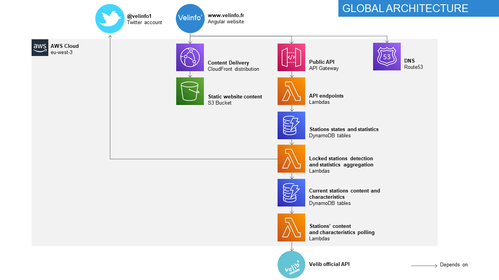

# velinfo

[](LICENSE)
[](https://twitter.com/velinfo1)

A serverless application that detects locked Velib stations (Paris' bicycle sharing system).

Hosted on AWS Serverless and visible at [velinfo.fr](https://www.velinfo.fr) and [@Velinfo1](https://twitter.com/velinfo1).

The raw data comes from the [Velib official API](https://www.velib-metropole.fr/donnees-open-data-gbfs-du-service-velib-metropole). Thanks to them!

## Table of contents
- [Architecture](#architecture)
- [Backend Lambdas](#backend-lambdas)
- [Technical stack](#technical-stack)
- [Build and deploy](#build-and-deploy)
- [License](#license)

## Architecture


The DNS records are managed through Route53.

The frontend application is built with Angular, hosted using a S3 bucket and cached through a Cloudfront Distribution.

The backend consists of several TypeScript Lambdas and Dynamo tables processing data fetched from the Velib API. The resulting data is exposed through an AWS API Gateway.

## Backend Lambdas
Each Lambda in `/lambda` has a single responsibility:
- **FetchStationsContent** / **FetchStationsCharacteristics** : periodically pull station availability and characteristics from the Velib API
- **ComputeStationsStates** : detect state changes (e.g. a station becoming locked) from the fetched data
- **ComputeUsage** / **ComputeMedianUsage** : aggregate station activity into usage statistics
- **PublishStateChangeTweet** : tweet about newly detected state changes
- **GetStations** / **GetStateChanges** / **GetActivityByStations** / **GetNetworkActivity** / **GetPredictionByStations** / **GetNetworkPrediction** : API-facing Lambdas that expose the processed data to the frontend

Shared code (Dynamo access, date/type utilities, domain objects) lives in `/lambda/common`.

## Technical stack
- **Languages** : Typescript, both for the backend (AWS Lambda) and the frontend (Angular)
- **Data storage** : AWS DynamoDb
- **Infrastructure / Deployment tooling** : [AWS SAM](https://docs.aws.amazon.com/serverless-application-model/latest/developerguide/what-is-sam.html) (superset of AWS CloudFormation dedicated to the serverless applications)
- **Main Libraries used** : 
    - [aws-sdk](https://www.npmjs.com/package/aws-sdk) for everything AWS
    - [date-fns](https://www.npmjs.com/package/date-fns) for easing the date management without the overhead of moment
    - [class-transformer](https://www.npmjs.com/package/class-transformer) to simplify the conversion between Typescript / ES6 types and the Dynamo stored objects.
    - [twit](https://www.npmjs.com/package/twit) to use the Twitter API
    - [axios](https://www.npmjs.com/package/axios) to easily fetch data from the Velib API
    - [aws-sam-webpack-plugin](https://www.npmjs.com/package/aws-sam-webpack-plugin) to use TypeScript within AWS SAM
    - [@angular/material](https://www.npmjs.com/package/@angular/material) to use pre built Angular components
    - [@agm/core](https://www.npmjs.com/package/@agm/core) for an easy Google Map / Angular integration
    - [@swimlane/ngx-charts](https://www.npmjs.com/package/@swimlane/ngx-charts) for nice Angular charts

## Build and deploy 
What do you need ?
- NPM
- The AWS SAM CLI
- The Angular CLI

If you want to self host this application, it's possible. But the SAM template expects a certain number of parameters, mainly regarding the DNS certificates and the Twitter API keys, that are obviously not included in this repo.
### Backend
``` 
npm run build
sam deploy
``` 
The backend code is in the `/lambda` folder. The infrastructure configuration is defined in `template.yaml` (a SAM template). As TypeScript is not natively supported by SAM, we can't rely on `sam build`. Instead the build and preparation of the CloudFormation template is done via a custom build command.

### Frontend
```
cd frontend
ng build --prod
aws s3 rm s3://velinfo-frontend --recursive
aws s3 cp dist/velinfo s3://velinfo-frontend --recursive --cache-control max-age=31536000
```
The frontend is a standard Angular application which can be built using the [Angular CLI](https://angular.io/cli). Once built, the content needs to be pushed to the S3 bucket hosting the static part of the website.

## License
This project is licensed under the [MIT License](LICENSE).
